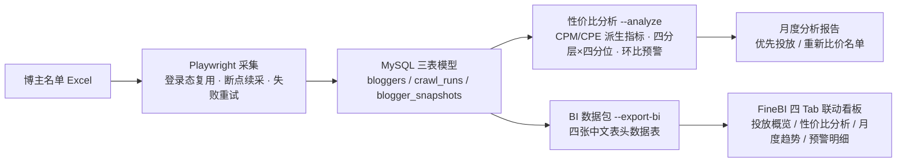
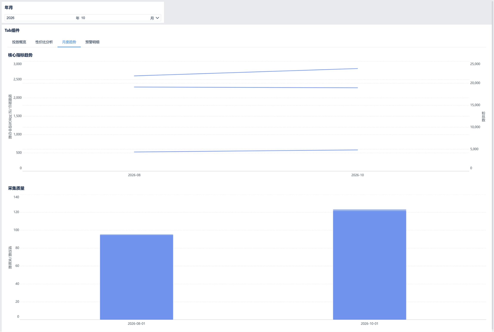

# blogger-analytics：博主数据采集与分析系统

> **声明**：本项目仅用于个人数据分析学习，不用于任何商业用途；仓库仅包含代码、测试与示例配置，不包含任何真实采集数据，亦不对外分发任何数据。

按月采集博主合作数据 → 落库 MySQL（三表模型）→ 生成性价比分析报告 → 导出 FineBI / Power BI 数据包，覆盖“采集 → 建模 → 分析 → 可视化”完整链路。

**技术栈**：Python、Playwright、MySQL、openpyxl、PowerShell、Windows Task Scheduler、FineBI

**核心特性**

- 批量采集：Playwright 复用登录态逐位采集，支持断点续采、失败重试、失败账号隔离重跑与 dry-run 校验
- 数据建模：`bloggers` / `crawl_runs` / `blogger_snapshots` 三表模型，名单停用只标 `inactive` 不删历史，支持批次追溯与月度对比
- 性价比分析（`--analyze`）：CPM／CPE／互动率派生指标、粉丝四分层×CPM 四分位分层、环比溢价预警与性价比提升信号
- BI 数据包（`--export-bi`）：四张中文表头数据表，FineBI / Power BI 直接导入建看板
- 工程质量：85 项单元测试覆盖采集、配置、数据库、报告、分析与调度全链路；Windows 任务计划程序月度自动运行

## 系统架构



## 看板效果

基于 `--export-bi` 导出的数据包，用 FineBI 搭建四 Tab 联动监控看板：全局月份过滤跨页联动，环比“红绿灯”自动着色（溢价预警标红、性价比提升标绿），新月份数据入库看板自动扩展。以下截图均为汇总指标，不含任何博主个人信息：



*月度趋势 Tab：核心指标双轴折线、采集质量*

## 功能概览

这是一个用于按月采集博主数据并生成 Excel 结果的本地工具。

当前版本支持使用本机浏览器登录态采集博主数据，并保留离线模拟模式：

1. 从 Excel 读取博主名单。
2. 根据 `run.mode` 选择离线模拟采集或真实采集。
3. 真实采集博主详情页“合作笔记”下的近30日和近90日数据。
4. 导出月度 Excel 结果表；正式运行时可将采集结果写入 MySQL，dry-run 模式不会写入数据库。

## 文件说明

- `data/blogger_list.xlsx`：输入的博主名单。
- `exports/`：导出的结果表。
- `logs/`：每次运行的成功、失败和汇总日志。
- `reports/`：月度变化和异常提醒报告。
- `backups/`：MySQL 数据库备份文件。
- `runtime/checkpoints/`：运行中断时的本地断点文件，不提交 Git。
- `scripts/`：Windows 月度任务启动和注册脚本。
- `config.example.yaml`：配置文件模板，不放真实密码。
- `config.yaml`：本地真实配置，MySQL 密码通过环境变量提供。
- `src/main.py`：命令行运行入口。
- `src/blogger_crawler/`：核心功能代码，其中 `selectors.py` 集中管理页面选择器与接口路径，页面改版时优先更新该文件。
- `tests/`：本地测试代码。

## 当前项目状态

截至 2026-10-22，项目已实现从 Excel 名单导入、真实采集到月度 Excel 导出的完整流程，并支持离线模拟、断点续采、失败重试、MySQL 写入和月度变化报告。

- 当前名单包含 123 位博主，以博主ID作为唯一标识。
- 最近一次真实 dry-run 于 2026-10-12 完成：123 位中 122 位成功、1 位失败；结果位于 `exports/2026-10_real_result.xlsx`，没有写入 MySQL。
- 失败的 1 位博主：搜索接口对其返回 0 个候选账号，未能采集到数据；失败状态和原因保留在结果表中。
- 上述 122/123 是一次运行结果，不代表未来批次的固定成功率。
- MySQL 写入、月度变化报告和 Windows 定时任务均已实现相应代码或脚本；本次采集为 dry-run，未据此验证数据库已更新或报告已生成。
- 每月 25 日 02:00 的自动任务默认处于暂停状态。若需启用或核实，请在 Windows 任务计划程序中检查 `Blogger Crawler Monthly`。
- 本仓库不含任何真实采集数据；数据库内容与备份均在本地维护，不进入版本库。

近30日和近90日指标均来自博主详情页的“合作笔记”筛选，不使用“日常笔记”数据代替。真实采集数据以当次接口返回结果为准；搜索不到的账号会标为失败，不用模拟数据补齐。

## 每月正式操作流程

1. 在当前 PowerShell 窗口输入 MySQL 密码：

   ```powershell
   $env:MYSQL_PASSWORD = Read-Host "请输入MySQL密码"
   $env:PYTHONPATH='src'
   ```

2. 先备份当前 MySQL：

   ```powershell
   .\.venv\Scripts\python.exe src\main.py --config config.yaml --backup
   ```

3. 确认 `.session/session.json` 登录态仍有效。
4. 在 `config.yaml` 中确认 `run.mode: real`。
5. 先执行真实 dry-run，检查 Excel 和日志：

   ```powershell
   .\.venv\Scripts\python.exe src\main.py --config config.yaml --dry-run
   ```

6. 确认结果无误后，执行正式采集并写入 MySQL：

   ```powershell
   .\.venv\Scripts\python.exe src\main.py --config config.yaml
   ```

7. 生成本月和上月的变化报告：

   ```powershell
   .\.venv\Scripts\python.exe src\main.py --config config.yaml --report
   ```

8. 需要保留本次数据库状态时，再执行一次 `--backup`。

如果采集过程中断，使用同一个月份执行：

```powershell
.\.venv\Scripts\python.exe src\main.py --config config.yaml --resume
```

如果只想重跑上一次失败的博主：

```powershell
.\.venv\Scripts\python.exe src\main.py --config config.yaml --retry-failed
```

正常运行会复用一个浏览器和登录上下文处理整批博主。任务完成后，如果上月有数据，报告会在 `reports/` 生成 `YYYY-MM_change_report.xlsx`；指标相对上月变化绝对值达到 `report.alert_threshold_percent` 时会进入“异常提醒”工作表。名单减少时，MySQL 只把旧博主标为 `inactive`，不会删除历史快照。

## 性价比分析报告（--analyze）

在完成某月采集后（dry-run 导出的结果表即可，不依赖 MySQL），生成博主性价比分析报告：

```powershell
$env:PYTHONPATH='src'
.\.venv\Scripts\python.exe src\main.py --config config.yaml --analyze --month 2026-10 --prev-month 2026-08
```

`--prev-month` 省略时默认取上一个月；上期结果表不存在时自动跳过环比部分。报告输出到 `reports/YYYY-MM_analysis.xlsx`，包含四个工作表：

- `摘要`：分层人数、CPM 中位数、预警数量与指标口径说明。
- `分析总览`：全部博主及派生指标，含质量标记（视频报价为0、近30天无合作笔记曝光、阅读中位数为0）。
- `性价比榜单`：按 CPM（视频报价 / 近30天曝光中位数 × 1000）升序的排名表，前 25% 标绿；同时给出 CPE（元/次互动）、单阅读成本与互动率。
- `环比与溢价预警`：与上期可比博主的粉丝/报价/曝光/互动变化；报价涨幅比互动涨幅高出 `report.alert_threshold_percent` 个百分点时标记"溢价预警"，反之标记"性价比提升"，粉丝环比变动超过 50% 标记"粉丝异动"。

粉丝分层口径：头部 ≥50万、腰部 10-50万、初级 1-10万、KOC <1万。性价比分层按 CPM 四分位划分，CPM 最低 25% 为"高性价比"。

## BI 数据包导出（--export-bi）

把各月结果表整理成 FineBI / Power BI 可直接导入的中文表头数据表：

```powershell
$env:PYTHONPATH='src'
.\.venv\Scripts\python.exe src\main.py --config config.yaml --export-bi
```

输出到 `bi/` 目录，包含四张表：`bloggers.xlsx`（博主维表）、`blogger_snapshots.xlsx`（月度快照事实表，含 CPM/CPE 等派生指标与分层）、`crawl_runs.xlsx`（运行记录）、`blogger_changes.xlsx`（相邻月份环比宽表，含溢价预警标记）。每次采集后重跑即可刷新数据包。注意：`博主ID` 在 BI 中需设置为文本类型，CPM/CPE 等率类指标汇总方式用平均值或中位数。

## 运行测试

```powershell
$env:PYTHONPATH='src'; $env:PYTHONUTF8='1'
.\.venv\Scripts\python.exe -m unittest discover -s tests -v
```

项目代码使用 Python 3.10+ 语法，当前已验证的项目环境是 Python 3.12。首次运行先在项目根目录创建独立环境：

```powershell
python -m venv .venv
.\.venv\Scripts\python.exe -m pip install -r requirements.txt
.\.venv\Scripts\python.exe -m playwright install chromium
```

如果系统默认 `python` 是 3.9，需要先安装或指定 Python 3.10 及以上版本来创建 `.venv`。月度任务启动脚本会优先使用 `.venv\Scripts\python.exe`。

## 运行离线模拟版

```powershell
.\.venv\Scripts\python.exe src\main.py --config config.example.yaml --dry-run
```

离线模拟版会读取博主名单、生成模拟数据，并导出 Excel 结果表。
这个模式不会连接 MySQL。
每次运行也会在 `logs/` 下生成运行日志；某个博主临时失败时默认最多重试2次，仍失败才会保留失败快照，不会让整批任务直接中断。运行中的断点文件保存在 `runtime/checkpoints/`，整批成功后会自动删除。

名单为空、重复博主ID、含空格的博主ID会在采集前直接报错，避免生成不完整结果。

## 采集模式

`config.yaml` 里的 `run.mode` 控制采集器：

- `mock`：离线模拟模式，便于测试本地流程。
- `real`：真实采集模式。使用 `.session/session.json` 搜索博主，打开博主详情页的“合作笔记”，读取近30日和近90日真实指标。

真实模式会在同一个 Playwright 浏览器和登录上下文中依次处理博主；每位博主只新建和关闭临时页面。

## 登录准备

正式登录时，先在 `config.yaml` 填写数据源登录页地址和登录态保存路径（以下为占位示例）：

```yaml
source:
  login_url: https://example.com/login
  search_url: https://example.com/search
  session_path: .session/session.json
  request_timeout_ms: 30000
```

先按“运行测试”一节创建 `.venv` 并安装浏览器依赖，然后运行：

```powershell
.\.venv\Scripts\python.exe src\main.py --config config.yaml --login
```

程序会打开可见浏览器。账号、密码、短信验证码、图形验证和扫码确认都由你在本机浏览器中完成；程序会在受保护搜索页验证登录成功后保存浏览器登录态，不会把密码或短信验证码写入文件。

登录完成后，将 `run.mode` 改为 `real`，先用 dry-run 验证真实采集：

```yaml
run:
  mode: real
```

```powershell
.\.venv\Scripts\python.exe src\main.py --config config.yaml --dry-run
```

成功后会在 `exports/` 生成带 `_real_result.xlsx` 后缀的真实结果，并在 `logs/` 记录每位博主的成功或失败原因。

## Windows 每月自动任务

任务注册脚本默认设置为每月 25 日 02:00。自动采集默认处于暂停状态，可在 Windows 任务计划程序中确认任务是否注册及启用。该任务按交互方式运行，启用后需要电脑开机、当前 Windows 用户已登录、网络可用、用户级 `MYSQL_PASSWORD` 已持久配置，并且 `.session/session.json` 仍有效；任一条件不满足都会导致任务停止或采集失败。任务启动脚本执行正式采集，随后生成月度报告。

查看或重新注册任务前，可以先预览：

```powershell
powershell.exe -NoProfile -ExecutionPolicy Bypass -File .\scripts\register_monthly_task.ps1 -Preview
```

需要重新注册时运行：

```powershell
powershell.exe -NoProfile -ExecutionPolicy Bypass -File .\scripts\register_monthly_task.ps1
```

任务实际执行的入口是 `scripts/run_monthly_crawl.ps1`。它会在缺少 MySQL 环境变量、配置文件或登录态时直接停止并提示原因，不会把密码写入脚本。

## 后续连接 MySQL

当前项目支持两种 MySQL 写入方式：

1. 如果安装了 Python 驱动，会优先用 `mysql-connector-python`。
2. 如果没有安装驱动，会自动使用本机 MySQL 自带的 `mysql.exe`。

写入前程序会自动执行建库建表脚本，准备这三张表：

- `bloggers`：博主基础信息。
- `crawl_runs`：每次采集运行记录。
- `blogger_snapshots`：每月博主数据快照。

不要把 MySQL 密码直接写入配置文件。本地 `config.yaml` 的 `mysql` 部分只保留环境变量名：

```yaml
mysql:
  password_env: MYSQL_PASSWORD
```

然后在当前 PowerShell 窗口中输入密码：

```powershell
$env:MYSQL_PASSWORD = Read-Host "请输入MySQL密码"
$env:PYTHONPATH='src'
.\.venv\Scripts\python.exe src\main.py --config config.yaml --dry-run
.\.venv\Scripts\python.exe src\main.py --config config.yaml
```

用 `$env:` 设置的变量只对当前 PowerShell 窗口有效，关闭窗口后需要重新输入。Windows 定时任务需要通过 Windows“用户环境变量”界面预先持久配置同名变量；不要把密码写进脚本、README 或 `config.yaml`。这样可以先用 dry-run 检查真实采集，再执行正式 MySQL 写入。仍需确认 MySQL 用户有创建数据库和建表权限。

如果没有配置 `mysql.password_env`，程序仍兼容旧的 `mysql.password` 配置方式。

报告阈值可以在 `config.yaml` 中调整：

```yaml
report:
  alert_threshold_percent: 30
```

如果以后想安装 Python 驱动，可以运行：

```powershell
.\.venv\Scripts\python.exe -m pip install mysql-connector-python
```

配置好 `config.yaml` 后，运行：

```powershell
.\.venv\Scripts\python.exe src\main.py --config config.yaml
```

## 测试数据和正式数据

正式名单确定后，如果要清理当前月份的测试快照和运行记录，再进行正式采集：

```powershell
$env:PYTHONPATH='src'; .\.venv\Scripts\python.exe src\main.py --config config.yaml --reset-month 2026-08 --yes
.\.venv\Scripts\python.exe src\main.py --config config.yaml
```

这个操作只删除指定月份的 `blogger_snapshots` 和 `crawl_runs`，不会删除 `bloggers` 基础名单表。正式采集后，Excel 会被同月份的新结果覆盖，MySQL 会写入正式名单结果。

## MySQL备份

使用本机 `mysqldump.exe` 备份当前数据库：

```powershell
$env:PYTHONPATH='src'; .\.venv\Scripts\python.exe src\main.py --config config.yaml --backup
```

备份文件默认保存到 `backups/`。如果程序找不到 `mysqldump.exe`，在 `config.yaml` 的 `mysql.dump_path` 中填写实际路径。备份文件和包含本地配置的 `config.yaml` 都不要提交到 Git。

## 真实采集字段说明

真实采集字段包括博主ID、账户名、粉丝数、图文/视频报价、标签，以及详情页“合作笔记”下的近30日和近90日发布笔记数、曝光中位数、阅读中位数和互动中位数。30/90日指标来自详情页对应的合作笔记筛选，不使用日常笔记数据代替。
